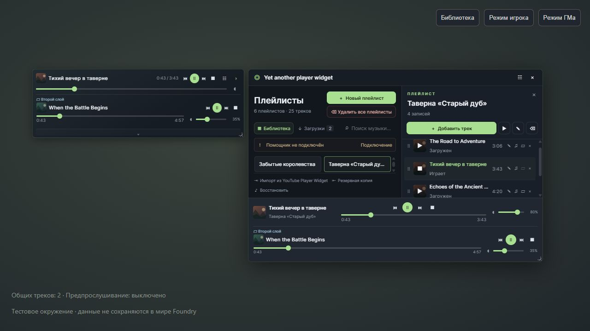
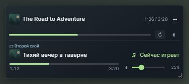
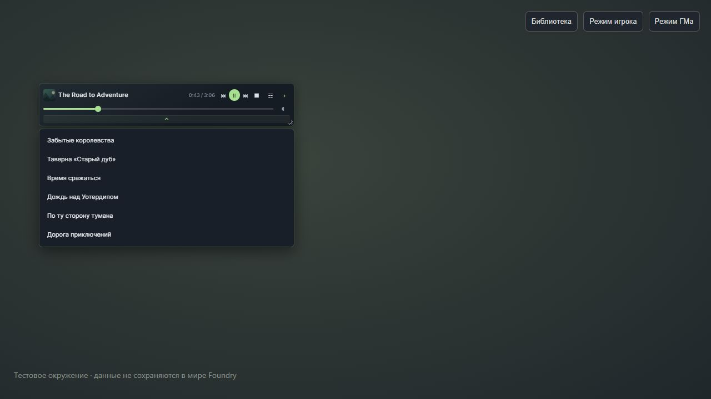
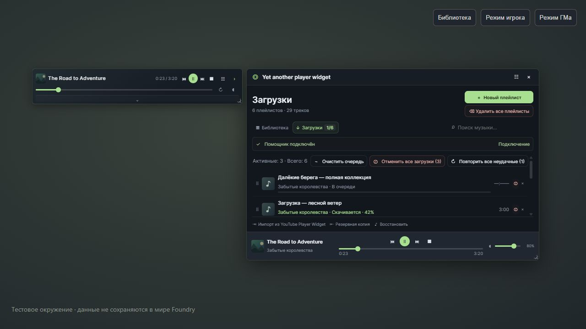

# Yet another player widget

Музыкальный плеер для **Foundry VTT v13**: компактный виджет, плейлисты, два независимых слоя музыки и загрузка YouTube с превью. Интерфейс на русском языке. Обычные аудиофайлы работают сразу; для скачивания с YouTube используется помощник на компьютере сервера Foundry.

**[Скачать последний релиз](https://github.com/Shizorium/Yet-another-player-widget/releases/latest)** · **[История изменений](CHANGELOG.md)** · **[Сообщить об ошибке](https://github.com/Shizorium/Yet-another-player-widget/issues)**

## Оглавление

- [Возможности](#features)
- [Требования](#requirements)
- [Установка в Foundry](#installation)
- [Первый запуск и Helper.exe](#helper)
- [Мини-плеер и раскрывающийся список](#mini-player)
- [Библиотека и плейлисты](#playlists)
- [Добавление музыки](#add-music)
- [Воспроизведение и два слоя](#playback)
- [Синхронизация звука](#synchronization)
- [Предпрослушивание только для ГМа](#preview)
- [Очередь, отмена и повтор загрузок](#downloads)
- [Импорт из Foundry](#import-foundry)
- [Импорт YouTube Player Widget](#import)
- [Настройки, громкость и права](#settings)
- [Хранение и резервные копии](#backups)
- [Обновление модуля](#updates)
- [Сервер в локальной сети, HTTPS и другие системы](#hosting)
- [Частые проблемы](#troubleshooting)
- [Разработка, проверки и подготовка релиза](#development)
- [Компоненты и лицензии](#licenses)

<a id="features"></a>
## Возможности

- Маленький перемещаемый плеер с обложкой, названием, временем, прогрессом и управлением. У игроков он виден во время общей музыки и остаётся при паузе.
- Библиотека в отдельном растягиваемом окне справа, маленькие карточки плейлистов и панель треков.
- Раскрывающийся список под мини-плеером: текущий плейлист, переход к списку всех плейлистов и обратно.
- Файлы с компьютера, аудиофайлы из хранилища Foundry, видео и целые плейлисты YouTube.
- Автоматическая очередь скачивания MP3 и JPG-превью, состояния, ошибки, повтор и отмена.
- Два независимых слоя музыки с сохранённой громкостью каждого слоя.
- Отдельные кнопки автовоспроизведения и автоповтора для каждого слоя; обе включены по умолчанию, повтор имеет приоритет.
- Личное предпрослушивание ГМа со случайной позиции между 30% и 50% трека.
- Перетаскивание для сортировки и переноса треков между плейлистами.
- Импорт всех плейлистов установленного YouTube Player Widget и резервная копия библиотеки в JSON.
- Один `Helper.exe` для Windows x64 со всеми необходимыми программами внутри.



<a id="requirements"></a>
## Требования

| Часть | Требование |
| --- | --- |
| Foundry | Версия 13; модуль не зависит от игровой системы |
| Управление музыкой | Учётная запись ГМа |
| Обычные аудиофайлы | Доступный файл и поддержка его формата браузером |
| Готовый помощник | Windows 10/11 x64 на компьютере сервера Foundry |
| Загрузка YouTube | Работающий помощник и доступ сервера к YouTube |
| Импорт старой библиотеки | YouTube Player Widget (`fvtt-youtube-player`) в том же мире |

Игрокам устанавливать или запускать помощник не нужно. Node.js, Python, yt-dlp и FFmpeg отдельно для `Helper.exe` не требуются. На Linux/macOS доступен [запуск из исходников](#hosting).

<a id="installation"></a>
## Установка в Foundry

### Через манифест — рекомендуемый способ

1. Откройте экран настройки Foundry → **Дополнительные модули / Add-on Modules** → **Установить модуль / Install Module**.
2. В поле **Manifest URL / URL манифеста** вставьте:

   ```text
   https://github.com/Shizorium/Yet-another-player-widget/releases/latest/download/module.json
   ```

3. Нажмите **Установить** и дождитесь завершения. Архив включает `helper/Helper.exe`; скачивание может занять время.
4. Откройте мир → **Настройки игры → Управление модулями**, включите **Yet another player widget** и сохраните изменения.
5. У ГМа появится мини-плеер. Двойной щелчок по названию или обложке откроет библиотеку. Создайте плейлист и добавьте музыку.

Для файлов помощник не нужен. Для YouTube выполните [следующий раздел](#helper).

### Установка вручную

1. На [странице релиза](https://github.com/Shizorium/Yet-another-player-widget/releases/latest) скачайте **`yet-another-player-widget-1.7.1.zip`** из списка Assets. Для будущих версий выбирайте ZIP с соответствующим номером.
2. Распакуйте папку `yet-another-player-widget` в **папку пользовательских данных Foundry → `Data/modules`**. В результате `module.json` должен находиться непосредственно в `Data/modules/yet-another-player-widget/`, без второй вложенной папки с тем же именем.
3. Перезапустите Foundry и включите модуль в мире.

Автоматические архивы GitHub **Source code (zip/tar.gz)** содержат исходники без готового `Helper.exe`. Для обычной установки используйте ZIP из Assets или манифест.

<a id="helper"></a>
## Первый запуск и Helper.exe

Помощник запускается **на компьютере сервера Foundry**, где находится установленный модуль.

1. Откройте `Data/modules/yet-another-player-widget/helper/` и запустите **`Helper.exe`** двойным щелчком.
2. При первом запуске дождитесь подготовки встроенных программ. Интернет для их извлечения не нужен.
3. В окне помощника появятся адрес **`http://127.0.0.1:32123`** и ключ подключения.
4. В мини-плеере нажмите значок ползунков → введите адрес и ключ → **Проверить подключение** → **Сохранить**.
5. Оставьте окно помощника открытым на время скачивания. Готовые файлы воспроизводятся и после его закрытия.

Ключ вводит ГМ; он сохраняется в его браузере. Помощник использует один активный ГМ мира. Другим участникам подключение не требуется. Не публикуйте ключ и файл cookies в сообщениях об ошибках.

Внутри EXE: **Node.js 24.22.1**, **yt-dlp 2026.10.26**, **FFmpeg и ffprobe 9.0.2**. Размер EXE — около **222 МиБ**, полного архива — около **166 МиБ**. При первом запуске компоненты извлекаются в `%LOCALAPPDATA%\YetAnotherPlayerWidget\runtime\<сборка>` и занимают дополнительное место. Контрольные суммы проверяются при запуске, повреждённые файлы восстанавливаются из EXE. Права администратора и изменение PATH не нужны.

Скрипты `Start-Helper.cmd` и `Start-Helper.ps1` также запускают EXE, когда он присутствует. Помощник не запускается автоматически из браузера Foundry. EXE не подписан цифровой подписью издателя; проверяйте источник скачивания и при необходимости SHA-256 из релиза.

<a id="mini-player"></a>
## Мини-плеер и раскрывающийся список

Мини-плеер по умолчанию занимает **460 × 78 пикселей** без второго слоя.

| Элемент или действие | Результат |
| --- | --- |
| Перетаскивание за название или обложку | Перемещение по экрану |
| Правый нижний угол | Изменение размера |
| Двойной щелчок по названию/обложке (ГМ) | Открытие библиотеки справа |
| Маленькая стрелка у правого края (ГМ) | Открытие библиотеки |
| `Ctrl + Alt + M` (ГМ) | Открытие или закрытие библиотеки |
| Ползунки | Размер, масштаб и подключение помощника |
| Прогресс внизу | Позиция трека; ГМ может перемотать нажатием на любую точку |
| Круговые стрелки рядом с громкостью | Ручная синхронизация звука на этом компьютере, доступна и игроку |
| Динамик справа от прогресса | Наведение, щелчок или фокус с клавиатуры открывают громкость |
| Широкая стрелка вниз (ГМ) | Раскрытие списка под мини-плеером |

Раскрытие списка и библиотека доступны **только ГМу**. При каждом раскрытии показывается текущий плейлист **основного слоя**. Длинный список прокручивается. Стрелка **Назад к плейлистам** вверху открывает список всех плейлистов, состоящий только из названий. Щелчок по названию показывает его треки в этом же окошке. При повторном закрытии и раскрытии снова открывается текущий основной плейлист.

У игрока видны активные треки, включая паузу, время и полосы прогресса, личная громкость и синхронизация. Стрелок, библиотеки и списков плейлистов нет. Обе полосы показывают ход трека без возможности перемотки, а текущее время и длительность под таймлайнами остаются видимыми даже при ширине 180 пикселей.



В этом списке ГМ может запускать, останавливать, предпрослушивать и добавлять треки вторым слоем, а также перетаскивать их. Для редактирования библиотеки и добавления музыки откройте большую версию.



<a id="playlists"></a>
## Библиотека и плейлисты

Библиотека открывается отдельным окном **640 × 420 пикселей** справа от мини-плеера. Перемещайте её за заголовок, растягивайте за правый нижний угол. Пока окно прикреплено к мини-плееру, оно перемещается вместе с ним; перемещение самой библиотеки открепляет её до следующего открытия. Размеры сохраняются.

### Создание, поиск и редактирование

1. Нажмите **Новый плейлист**, задайте название и сохраните.
2. Нажмите на маленькую прямоугольную карточку с названием: справа откроются треки. Повторный щелчок по той же карточке закрывает панель. В узком окне панель накладывается на часть библиотеки.
3. В панели доступны **Добавить музыку**, запуск плейлиста, переименование и удаление.

Поиск вверху находит плейлисты и треки. У отдельного трека значок карандаша позволяет изменить название, исправить источник или перенести его в другой плейлист. Крестик убирает запись из плейлиста.

### Порядок и перенос треков

- Возьмите трек за название или маркер слева и перетащите между строками. Линия показывает место вставки; у края списка включается прокрутка.
- Бросьте трек на свободное место списка, чтобы переместить в конец.
- Бросьте трек на карточку другого плейлиста, чтобы перенести туда. Плейлист назначения подсвечивается.

Это работает в библиотеке и раскрывающемся списке мини-плеера. Порядок сохраняется и используется последовательным воспроизведением Foundry. Перенос сохраняет позицию и состояние играющего или приостановленного трека; незавершённая загрузка продолжает обновляться в новом плейлисте.

### Удаление плейлистов

Нажмите **правой кнопкой** на карточку → **Удалить** → подтвердите действие. Меню также открывается через `Shift + F10`, закрывается через `Escape`. Кнопка **Удалить все плейлисты** вверху библиотеки также требует подтверждения с количеством плейлистов.

Массовое удаление затрагивает все плейлисты **этого виджета**, в том числе скрытые поиском. Плейлисты других модулей сохраняются. Аудиофайлы и превью остаются на диске, незавершённые задания удалённых записей отменяются в помощнике.

<a id="add-music"></a>
## Добавление музыки

Откройте библиотеку → выберите плейлист → **Добавить музыку**. Название можно задать вручную; без него используется имя файла или название YouTube. Можно выбрать сразу несколько файлов. После ввода ссылки YouTube появляется следующее поле; список ссылок можно вставить целиком, разделив пробелами или переносами строк. Кнопка «Добавить» отправляет всю выбранную пачку в очередь.

| Источник | Как добавить | Что происходит |
| --- | --- | --- |
| Файл с компьютера | Выберите один или несколько аудиофайлов | Файлы загружаются в хранилище Foundry, прогресс виден во вкладке «Загрузки» |
| Файл в Foundry | Нажмите значок папки или укажите относительный путь, например `music/forest.ogg` | Используется существующий файл без повторного копирования |
| Видео YouTube | Вставьте ссылку на видео | Помощник скачивает аудио в MP3 и превью в JPG |
| Плейлист YouTube | Вставьте ссылку с параметром `list` | Список читается, его треки добавляются в выбранный плейлист и скачиваются по очереди |

Для одного видео из YouTube-плейлиста удалите параметр **`list`** из ссылки, иначе будет импортирован весь список. Поддерживаются обычные ссылки YouTube, `youtu.be`, Shorts, Music и ссылки на трансляции, если запись доступна загрузчику. Произвольные сайты для скачивания не поддерживаются.

В диалоге можно выбрать MP3, OGG, WAV, FLAC, M4A, AAC, WebM и Opus; воспроизведение локальных файлов зависит от браузера. Готовность трека, длительность и превью появляются по мере обработки. Если YouTube не предоставил превью, трек остаётся доступным с обычным значком музыки. Готовые файлы с тем же ID YouTube используются повторно.

<a id="playback"></a>
## Воспроизведение и два слоя

Нажмите кнопку на обложке готового трека для запуска на **основном слое**. Основное управление содержит предыдущий трек, паузу/продолжение, следующий трек, полную остановку и таймлайн. Видны название, текущая секунда и длительность.

- **Пауза** сохраняет трек и позицию.
- **Автовоспроизведение** (список с номерами) после окончания запускает следующий готовый трек того же плейлиста, по кругу и с пропуском трека другого слоя.
- **Автоповтор** (стрелки повтора) зацикливает текущий трек. Пока он включён, автовоспроизведение не переключает музыку. Чтобы слушать плейлист по порядку, отключите повтор у нужного слоя.
- Обе кнопки по умолчанию включены. Их состояния сохраняются отдельно для каждого слоя и действуют на следующие треки этого слоя.
- **Стоп** полностью останавливает выбранный трек и сбрасывает позицию. Следующий запуск начинается с начала. Это относится и к кнопке остановки на обложке строки.
- Запуск другого трека заменяет основной, в том числе при переходе в другой плейлист. Предыдущий основной трек не остаётся в «Сейчас играет» на паузе.
- Перемотка выполняется нажатием или перетаскиванием на таймлайне, когда длительность известна.

### Второй слой

Нажмите **значок слоёв** справа от готового трека, чтобы добавить его к основной музыке. Например, на основном слое может играть музыка боя, на втором — дождь или фоновая атмосфера. Если на втором уже есть трек, он заменяется.

Второй слой показан **под основным**, имеет собственные паузу, остановку, переключение, таймлайн и громкость. Переключение или остановка основного слоя его не выключает; треки могут быть из разных плейлистов. Переключение пропускает трек, уже занятый другим слоем.

Общая громкость каждого слоя, установленная ГМом, сохраняется в мире и применяется к следующим трекам этого слоя. Все регуляторы находятся в окне динамика на первом слое. У игрока регуляторы слоёв личные: 100% соответствует уровню ГМа, уменьшение и выключение влияют только на этого игрока. Личные значения сохраняются на клиенте и остаются после синхронизации и смены треков. **Вся музыка** дополнительно влияет на оба слоя только у текущего слушателя.

Во время смешивания виджет временно использует одновременный режим Foundry там, где это необходимо для независимости звуков; после остановки дополнительного слоя исходный режим плейлиста восстанавливается. Роли намеренно добавленных слоёв сохраняются при перезагрузке страницы.

<a id="synchronization"></a>
## Синхронизация звука

При ручном запуске, продолжении, перемотке и автоматическом переходе на следующий трек каждый участник с загруженным виджетом сначала полностью загружает звук. Игроки, уже видимые в списке Foundry, но ещё загружающие мир и сам виджет, не входят в счётчик и не задерживают музыку. После загрузки плеер сообщает о своей готовности; активный ГМ при входе запрашивает список работающих виджетов. Плеер показывает ожидание готовности звука только у этих участников. Когда они готовы, активный ГМ назначает общий момент старта по часам сервера с запасом 1,2 секунды для доставки команды. Уже загруженный звук используется для запуска без повторного скачивания. Слои ожидают готовности независимо: загрузка одного не прерывает другой.

После перемотки выбранная позиция остаётся на таймлайне во время загрузки и ожидания старта, затем продолжает двигаться по фактическому звуку. Кратковременное отсутствие позиции у ещё не запущенного звука не сбрасывает таймлайн в начало.

У ГМа видно количество готовых участников, а при наведении на синхронизацию — кого плеер ожидает. Ошибка загрузки или запрет звука браузером удерживают общий старт до устранения причины. Участнику с заблокированным звуком нужно щёлкнуть по странице. Отключившиеся участники перестают блокировать запуск. Участник, подключившийся после начала воспроизведения, загружает трек и догоняет общую позицию.

Подтверждения готовности передаются штатным каналом активности Foundry, поэтому не зависят от регистрации нового канала модуля на сервере. Если виджет участника уже сообщил о загрузке, но за 15 секунд от него не пришло ни одного ответа о звуке, плеер показывает его имя и предлагает обновить его страницу через **Ctrl+F5**. Такой участник не считается готовым. Участник без загруженного виджета пропускается; появившись после старта, он загружает звук и догоняет общую позицию.

Раз в секунду проверяется местный звук; расхождение более 0,3 секунды корректируется. Возвращение во вкладку и восстановление соединения запускают повторную проверку. Для длинных треков учитывается фактическая позиция браузерного аудио, чтобы замечать остановившийся поток.

Если у игрока пропал звук, осталась загрузка или музыка отстала, нажмите **круговые стрелки** рядом с громкостью в мини-плеере. Кнопка обновляет часы и заново открывает оба играющих трека только у нажавшего участника, сохраняя общие позиции и громкости. Она не переключает музыку у других слушателей. Кнопка есть и у ГМа для восстановления его собственного звука.

Одна попытка загрузки ограничена **60 секундами**. При неудаче выполняются до трёх попыток с задержками; затем кнопка показывает ошибку при наведении и позволяет повторить вручную. Отменённый или заменённый звук после позднего завершения загрузки не запускается. Недоступный файл или запрет воспроизведения браузером требуют устранения причины; идеальная синхронность до аудиосэмпла между разными устройствами не гарантируется. После установки этого обновления обновите страницы ГМа и всех игроков через **Ctrl+F5**. Перезапуск сервера для обмена готовностью не требуется.



<a id="preview"></a>
## Предпрослушивание только для ГМа

Значок **наушников** у готового трека включает звук **только в браузере нажавшего ГМа**. Основные слои временно глушатся у этого ГМа; игроки и другие ГМы продолжают слышать общую музыку. После окончания, остановки или ошибки предпрослушивания восстанавливается актуальная громкость слоёв. Начальная позиция выбирается случайно между **30% и 50%** длительности.

Повторное нажатие выключает предпрослушивание. Выбор другого трека в наушниках заменяет предыдущий. Функция доступна в библиотеке, среди готовых загрузок и в раскрытом списке мини-плеера. Предпрослушивание не показывает мини-плеер игрокам.

<a id="downloads"></a>
## Очередь, отмена и повтор загрузок

Во вкладке **Загрузки** показаны задания YouTube и передачи файлов с компьютера, проценты и текст ошибок. Помощник скачивает последовательно и сохраняет свою очередь на диск. При его перезапуске незавершённые задания возвращаются в работу. Для передачи новых заданий и синхронизации нужен открытый Foundry с активным ГМом.

Название вкладки содержит счётчик **Загрузки 2/10**: слева количество готовых записей, справа общее количество в текущей истории, включая ожидающие, ошибочные и отменённые. Поиск не меняет счётчик. Очистка истории убирает завершённые записи из подсчёта; после чтения YouTube-плейлиста его запись заменяется полученными треками, поэтому итоговое количество уточняется.

| Состояние | Значение |
| --- | --- |
| В очереди | Задание ожидает отправки или своей очереди |
| Чтение плейлиста | Помощник получает список видео YouTube |
| Скачивается | Получение аудио и превью |
| Обработка | Преобразование звука и картинки |
| Загрузка файла | Передача файла с компьютера в Foundry |
| Загружен | Трек готов к воспроизведению |
| Ошибка | Причина показана рядом с треком |
| Отменяется | Запрос отмены сохранён и ожидает подтверждения помощника |
| Отменено | Задание остановлено; его можно возобновить вручную |

### Повтор

Круговая стрелка повторяет один неудачный трек. **Повторить все неудачные** запускает ошибки, которые ещё отображаются в очереди. Отменённые записи возобновляются отдельно кнопкой **Возобновить загрузку** и не включаются в повтор всех ошибок.

После перезагрузки страницы браузер теряет доступ к выбранному файлу компьютера: для повторной передачи его нужно снова выбрать через **Добавить музыку**. YouTube-задания не требуют повторного ввода ссылки.

### Отмена

| Кнопка | Область действия |
| --- | --- |
| Значок отмены рядом с треком | Только этот трек |
| **Отменить все** над треками выбранного плейлиста | Все его незавершённые загрузки |
| **Отменить все загрузки** во вкладке «Загрузки» | Все незавершённые загрузки библиотеки |

Массовые действия учитывают записи, скрытые поиском. Отмена синхронизируется с помощником: снимает ожидающее задание, останавливает загрузчик и его процесс обработки. При отсутствии связи запрос сохраняется в мире и отправляется после подключения; запись остаётся в состоянии **Отменяется** до подтверждения. Самопроизвольного повторного скачивания отменённых заданий после перезапуска нет.

Отмена чтения YouTube-плейлиста прекращает получение списка. Если список уже прочитан, отменить оставшиеся треки можно общей кнопкой выбранного плейлиста. Отмена загрузки файла прерывает передачу в браузере.

Активный ГМ также сверяет очередь помощника с библиотекой: задания удалённых треков и плейлистов отменяются, задания перенесённых треков сохраняются. Записи других миров не затрагиваются.

### Очистка истории

**Очистить очередь** убирает из вкладки завершённые, отменённые и ошибочные записи во всех плейлистах. Активные задания и ожидающие подтверждения отмены остаются. Треки в плейлистах, файлы, превью и воспроизведение сохраняются.

Очистка сохраняется после перезагрузки. При ручном повторе или возобновлении запись снова появляется в очереди. Эта кнопка очищает историю интерфейса; для остановки активных заданий используйте отмену. Существующие файлы Foundry, добавленные без передачи, в историю загрузок не включаются.

<a id="import-foundry"></a>
## Импорт из Foundry

Нажмите **Импорт из Foundry** внизу библиотеки, отметьте обычные плейлисты приложения и нажмите **Импортировать**. Их аудиофайлы сразу появятся в библиотеке без повторной загрузки. Исходные плейлисты, файлы и воспроизведение сохраняются. Повторный импорт выбранного плейлиста добавляет только новые записи.

<a id="import"></a>
## Импорт YouTube Player Widget

1. Включите **YouTube Player Widget** (`fvtt-youtube-player`) в том же мире.
2. Откройте большую библиотеку и нажмите внизу **Импорт из YouTube Player Widget**.
3. Его плейлисты появятся здесь, а треки встанут на скачивание вместе с превью.

Импорт читает настройку `fvtt-youtube-player.playlists`; проверен формат версии **3.0.1**. Повторный импорт добавляет новые ссылки без дублирования ранее импортированных. Некорректные ссылки отображаются как ошибки для ручного исправления. Исходные плейлисты сохраняются.

Если старый модуль уже воспроизводит музыку, остановите его плеер перед запуском музыки здесь: импорт не управляет воспроизведением другого модуля. Для работы самого виджета YouTube Player Widget не обязателен.

<a id="settings"></a>
## Настройки, громкость и права

Откройте значок ползунков в мини-плеере или библиотеке:

- Ширина мини-плеера: **180–800 пикселей**; высота основной части: **48–140 пикселей**. При ширине меньше 300 пикселей или высоте меньше 72 включается компактная раскладка с уменьшенными кнопками. Длинные названия автоматически прокручиваются; наведение приостанавливает строку. Текущее время и общая длительность расположены под таймлайном каждого слоя и остаются видимыми при уменьшении.
- Масштаб текста и кнопок: **80%, 100% или 120%**.
- Адрес и ключ помощника, кнопка проверки связи — у ГМа.

Положение, размеры окон, масштаб и личная громкость хранятся у каждого участника отдельно. Второй слой увеличивает высоту мини-плеера своей строкой.

Каждый игрок и ГМ могут включить **Затухание мини-плеера без наведения** в настройках модуля Foundry или в разделе **Видимость мини-плеера** окна настроек плеера. Затухание и прозрачность сохраняются лично для пользователя и не меняют вид плеера у других участников. Прежнее общее значение используется как начальное, пока участник не сохранит своё. Через 1,5 секунды без наведения мини-плеер становится прозрачным, при наведении и клавиатурном фокусе снова виден полностью. Работа с открытым окном громкости или списком треков также сохраняет видимость. Ползунок задаёт прозрачность от **0%** (полностью виден) до **100%** (полностью прозрачен); исходное значение — 80%. По умолчанию затухание выключено. Прозрачность не останавливает музыку.

| Возможность | ГМ | Игрок |
| --- | --- | --- |
| Видеть мини-плеер без общей музыки | Да | Нет |
| Видеть название, время и превью во время музыки | Да | Да |
| Смотреть плейлисты и открывать библиотеку | Да | Нет |
| Перемещать окно, менять размер и личную громкость | Да | Да |
| Запускать, перематывать, переключать, останавливать музыку | Да | Нет |
| Менять громкость слоёв для всех | Да | Нет |
| Предпрослушивать, редактировать, импортировать, управлять загрузками | Да | Нет |

Значок динамика на первом слое мини-плеера открывает громкость **всех активных слоёв**, включая слои на паузе: общую у ГМа и личную у игрока. Здесь же находится **Вся музыка**, которая использует музыкальную громкость Foundry и действует только у этого слушателя.

<a id="backups"></a>
## Хранение и резервные копии

| Данные | Где находятся |
| --- | --- |
| Плейлисты, порядок, метаданные, состояния | Документы Playlist и настройки мира Foundry |
| Готовый звук | Обычные PlaylistSound со штатной синхронизацией Foundry |
| YouTube MP3 и JPG | `Data/modules/yet-another-player-widget/storage/youtube/<video-id>/` |
| Файлы с компьютера | `Data/modules/yet-another-player-widget/storage/uploads/` |
| Очередь и ключ помощника | Папка `yapw-…` в системной временной папке компьютера сервера |
| Извлечённые программы Windows | `%LOCALAPPDATA%\YetAnotherPlayerWidget\runtime\<сборка>` |

**Резервная копия** внизу библиотеки скачивает JSON с плейлистами и метаданными. **Восстановить** добавляет плейлисты из этого файла к существующим. Аудио и картинки в JSON не включаются: отдельно сохраняйте папку **`storage`** и резервную копию мира. При восстановлении медиафайлы должны быть доступны по прежним путям.

В манифесте включён `persistentStorage`: Foundry v13 сохраняет папку `storage` при обновлении пакета. При ручной переустановке или удалении папки модуля сохраните её самостоятельно. Удаление трека или плейлиста через виджет не удаляет файлы с диска.

Очистка системной временной папки может удалить служебную очередь и ключ помощника. Плейлисты и готовые файлы при этом сохраняются; после запуска введите новый ключ в настройках. Перемещение модуля в другой путь также меняет каталог его служебного состояния.

<a id="updates"></a>
## Обновление модуля

1. Сделайте резервную копию мира и `storage`.
2. **Закройте помощник** перед обновлением: Windows может блокировать работающий EXE.
3. На экране настройки Foundry обновите модуль. При ручной установке используйте ZIP из нового релиза, сохранив `storage`.
4. Запустите новый `helper/Helper.exe` и обновите страницу мира через **Ctrl + F5**.

Постоянный URL манифеста указывает на последний стабильный релиз, а поле `download` в нём — на ZIP конкретной версии. Повторно устанавливать модуль для обычного обновления не нужно. При сохранённом пути и служебной папке очередь и ключ используются прежние.

Встроенные программы обновляются вместе с EXE. `Update-Downloader.ps1` нужен для исходной версии или подготовки сборки и **не обновляет программы внутри уже собранного Helper.exe**.

<a id="hosting"></a>
## Сервер в локальной сети, HTTPS и другие системы

### Другой адрес Foundry

По умолчанию разрешены источники `http://localhost:30000` и `http://127.0.0.1:30000`. Если Foundry открыт по другому адресу или порту, укажите его точный адрес без завершающего `/` перед запуском. Пример PowerShell из папки `helper`:

```powershell
$env:YAPW_ORIGINS = 'http://localhost:30000,http://127.0.0.1:30000,http://192.168.1.50:30000'
.\Helper.exe
```

Это разрешает запросы из указанной страницы, но не открывает сетевой порт другим компьютерам. Помощник слушает только **127.0.0.1**. Адрес `127.0.0.1:32123` подходит, когда браузер ГМа и сервер находятся на одном компьютере.

### Удалённый сервер или HTTPS

Помощник должен работать рядом с сервером Foundry, чтобы сохранять музыку в его `Data`. Для удалённого ГМа разместите его за защищённым **HTTPS reverse proxy**, направленным на локальный порт 32123. Добавьте HTTPS-источник Foundry в `YAPW_ORIGINS`, а в настройках виджета укажите HTTPS-адрес помощника. Не направляйте удалённый браузер на его собственный `127.0.0.1`; HTTPS-страница также может блокировать запросы к HTTP.

Конфигурация прокси зависит от хостинга. Хостинг без возможности запустить отдельный процесс или записывать файлы в папку модуля не поддерживает помощник; готовые аудиофайлы можно добавить обычным способом.

### Linux/macOS и исходная версия

Готовый EXE работает на Windows x64. Для других систем установите **Node.js 22+**, **yt-dlp** и **FFmpeg/ffprobe**, затем из корня модуля выполните:

```sh
node helper/server.mjs
```

В исходной версии нестандартные пути задаются через `YAPW_YTDLP`, `YAPW_FFMPEG` и `YAPW_NODE` для Windows-скрипта запуска. `YAPW_FFMPEG` принимает путь к FFmpeg или его каталогу. В EXE пути к программам выбираются автоматически из встроенного набора.

Для уже доступных вам авторизованных видео можно указать `YAPW_COOKIES` — путь к своему Netscape-файлу cookies. Он не копируется в модуль. Закрытые, удалённые и регионально ограниченные видео могут оставаться недоступны.

<a id="troubleshooting"></a>
## Частые проблемы

| Проблема | Что проверить |
| --- | --- |
| Мини-плеера нет | Включён ли модуль в этом мире; у игрока без общей музыки он скрыт. Попробуйте `Ctrl + Alt + M` |
| Ошибка при создании плейлиста | Установлена ли актуальная версия, обновлена ли страница через `Ctrl + F5`; старый конфликт со схемой v13 исправлен |
| Требуется Node.js или FFmpeg | Запускайте `helper/Helper.exe` из полного релизного ZIP; Source code не содержит EXE |
| Окно помощника закрывается | Запустите `Start-Helper.cmd` или EXE из терминала; после ошибки EXE ждёт Enter. Журнал запуска: `%LOCALAPPDATA%\YetAnotherPlayerWidget\helper-error.log` |
| «Помощник уже запущен» | Закройте прежнее окно или проверьте, какой процесс занимает порт 32123; второй экземпляр не меняет очередь |
| Неверный ключ | Скопируйте текущий ключ из окна помощника, проверьте подключение и сохраните настройки в браузере активного ГМа |
| Адрес отсутствует в `YAPW_ORIGINS` | Добавьте точный источник страницы Foundry, включая протокол и порт, и перезапустите помощник |
| Всё висит «В очереди» | Открыт ли мир с активным ГМом, запущен ли помощник, проходит ли проверка подключения; затем посмотрите причину ошибки во вкладке «Загрузки» |
| «Отменяется» не меняется | Восстановите связь с помощником и оставьте страницу активного ГМа открытой для отправки отмены |
| YouTube возвращает 429 или проверку на бота | Подождите и повторите позже; обновите модуль, если доступна новая версия. Автоматического обхода проверки нет |
| Трек готов, но нет звука | Щёлкните по странице для разрешения звука браузером; проверьте «Вся музыка», громкость слоя и доступность файла |
| Длительность `—:——` | Файл ещё не прочитан, недоступен или формат не поддерживается браузером; время появится после успешного чтения |
| Передача файла не повторяется после перезагрузки | Выберите исходный файл заново через «Добавить музыку» |
| У игрока звук отстал или долго загружается | Нажмите круговые стрелки рядом с громкостью мини-плеера. При повторной ошибке проверьте доступность файла и разрешение звука браузером |
| После обновления осталось старое поведение | Закройте старый помощник, запустите новый и выполните `Ctrl + F5` |

Для проверки встроенных программ без запуска очереди, из папки `helper`:

```powershell
.\Helper.exe --check
```

При обращении в [Issues](https://github.com/Shizorium/Yet-another-player-widget/issues) укажите версии Foundry и модуля, ОС, шаги и текст ошибки. Исключите ключ подключения и cookies из приложенных данных.

<a id="development"></a>
## Разработка, проверки и подготовка релиза

### Проверки

```sh
node tests/run.mjs
node tests/standalone-helper.mjs
```

Второй тест нужен только на Windows с собранным `Helper.exe`: он использует отдельные временные очередь, ключ и порт, проверяет запуск только из EXE с очищенным PATH, настоящий yt-dlp и FFmpeg на локальном аудио, MP3/JPG, API, отмену, защиту от второго экземпляра и восстановление компонентов. Живой мир и его очередь не используются. Пройдены **65 основных тестов**, включая три изолированных клиента с разной скоростью загрузки, пропуск участника без виджета и недоступный канал модуля, независимость слоёв, сохранение выбранной позиции до старта после перемотки, таймауты, запрет браузером, повтор и счётчик загрузок. Проверка реальных классов v13 дополнительно охватывает штатный канал активности, общий старт и перемотку. Сеть с несколькими физическими компьютерами и чистая виртуальная машина Windows в этой сессии не использовались.

Проверки реальных классов установленного v13 без открытия мира:

```sh
node tests/foundry-v13-schema.mjs "<Foundry>/resources/app"
node tests/foundry-v13-playback.mjs "<Foundry>/resources/app"
```

Предпросмотр интерфейса: `node tests/preview-server.mjs`, затем `http://127.0.0.1:32124/tests/preview.html`. Используются вымышленные данные. [Подробная история проверок и ограничения](docs/VALIDATION.md).

### Сборка EXE и архива

На Windows x64 из корня репозитория:

```powershell
powershell.exe -NoProfile -ExecutionPolicy Bypass -File helper/Build-Helper.ps1
powershell.exe -NoProfile -ExecutionPolicy Bypass -File helper/Package-Module.ps1
```

Для сборки EXE разработчику нужен npm. Версия postject закреплена в `helper/build-tools/package-lock.json`; компоненты и их SHA-256 — в `helper/component-sources.json`. Сборщик создаёт `Helper.exe`, его SHA-256 и `bundle-info.json`, проверяет исходные компоненты и удаляет прежнюю подпись Node у нового исполняемого файла. Лаунчер и сервер: `helper/launcher.cjs`, `helper/server.mjs`.

Упаковщик проверяет версии модуля и пакета, контрольные суммы EXE и соответствие встроенных сервера, модели и лицензий исходникам; сохраняет ZIP, манифест и `SHA256SUMS.txt` в `dist/`. Версия помощника может отличаться от версии интерфейса при неизменных исходниках помощника: выпуск 1.7.1 использует проверенный EXE 1.7.0. В ZIP входят EXE, исходники, инструкции и лицензии; музыка, ключи, служебная очередь, `node_modules`, `.git` и временные файлы сборки исключаются. Повторная копия `helper/bin/yt-dlp.exe` не нужна: программа уже внутри EXE.

Для следующего релиза обновите версии `module.json` и `package.json`, адрес `download` с тегом `v<версия>`, `CHANGELOG.md`, затем соберите архив и запустите проверки. Пересоберите EXE, если менялись его компоненты или исходники помощника; для изменений интерфейса допустима прежняя проверенная сборка. Публикуйте исходники и тег, а к релизу прикладывайте `module.json`, ZIP модуля, `Helper.exe`, `Helper.exe.sha256` и `SHA256SUMS.txt`. Постоянное поле `manifest` оставляйте без изменения.

Включаемые в EXE файлы должны соответствовать исходникам выпуска: при изменении сервера, модели, лаунчера или лицензий EXE необходимо пересобрать. Не добавляйте пользовательские медиафайлы или секреты в Git.

<a id="licenses"></a>
## Компоненты и лицензии

Лицензии и уведомления включённых программ находятся в [helper/licenses](helper/licenses); точные источники — в [SOURCES.md](helper/licenses/SOURCES.md) и [component-sources.json](helper/component-sources.json). В релизе есть контрольные суммы, а в `bundle-info.json` — состав EXE и SHA-256 компонентов.

- [Node.js](https://nodejs.org/) — среда помощника.
- [yt-dlp](https://github.com/yt-dlp/yt-dlp) — получение списка и аудио YouTube.
- [FFmpeg / ffprobe](https://ffmpeg.org/) — преобразование аудио, превью и проверка длительности; Windows-сборка [Gyan](https://www.gyan.dev/ffmpeg/builds/), GPLv3.
- [Foundry v13: Playlist](https://foundryvtt.com/api/v13/classes/foundry.documents.Playlist.html) и [PlaylistSound](https://foundryvtt.com/api/v13/classes/foundry.documents.PlaylistSound.html) — документы и синхронизация воспроизведения.
